  

I build apps that help you see where your screen time goes and catch private information in recordings before you share them. Both projects process your data locally.

## Projects

### [FrameGuard](https://github.com/motionedits246-max/FrameGuard)

**Review screen recordings before you hit publish.** FrameGuard uses on-device OCR to scan MP4 recordings for exposed API keys, email addresses, and your own keywords. Jump to flagged timestamps in the desktop app or run scans from the terminal.

[**Download FrameGuard**](https://github.com/motionedits246-max/FrameGuard/releases/latest) · [Source code](https://github.com/motionedits246-max/FrameGuard) · [Report an issue](https://github.com/motionedits246-max/FrameGuard/issues)

### [Digital Discipline](https://github.com/motionedits246-max/digital-discipline)

**See where your screen time goes.** Review app usage and browsing habits, set up focus sessions and site limits, and keep an eye on your day from a floating panel. Built for Windows with an optional browser companion.

[**Find a release**](https://github.com/motionedits246-max/digital-discipline/releases) · [Source code](https://github.com/motionedits246-max/digital-discipline) · [Report an issue](https://github.com/motionedits246-max/digital-discipline/issues)
